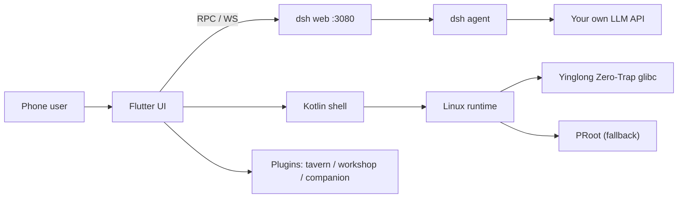

<div align="center">

# DSH NEXT

**DeepSeek Harness on your phone · switchable built-in plugins · the Yinglong runtime**

*A complete Linux toolchain and an AI coding agent inside an Android phone — no root, all local.*

[](https://github.com/SiFluxLab/DSH-NEXT/releases)
[](./LICENSE)

[](https://github.com/SiFluxLab/DSH-NEXT/releases)
[](#requirements)
[](#runtime-yinglong-instead-of-proot)
[](#what-this-is)
[](#what-this-is)
[](#architecture)

</div>

---

## What this is

| | |
|---|---|
| **Deliverable** | A signed Android APK: bundled Linux runtime + DeepSeek Harness engine + a native Flutter UI |
| **Launch engine** | Yinglong (Zero-Trap: a patched glibc translates paths in-process); fallback 应龙 → tawcroot → direct → PRoot |
| **Guest system** | Ubuntu 24.04 base (offline-built rootfs; real bash, node, git, ripgrep) |
| **Agent** | `@deepseek-ai/dsh` 0.2.2-rc.1 on Node 24.22.1, `dsh web` on a loopback port |
| **UI** | Flutter native screens, not the desktop web UI in a WebView |
| **Built-in plugins** | Tavern / Workshop / Companion, each switchable in Settings |
| **LLM** | Your own API key, set in the app; no model weights in the APK |
| **Data** | Local: everything lives in the app's private directory |

> This repository is a **rebranded fork of** [dsh-go](https://github.com/ccch1mneyyy/dsh-go):
> new name, new application id, the three big features turned into optional built-in plugins,
> and the runtime moved from PRoot to Yinglong. Every service the upstream author ran
> (update mirrors, relay, forum, workshop, plugin market, usage reporting) is disconnected and
> points at the reserved host `dshnext.invalid`. The licence is still **AGPL-3.0**;
> attribution is in [NOTICE](./NOTICE).

---

## Built-in plugins

The three features are no longer hard-wired entries; each is a plugin you can switch
off (Settings › Built-in plugins):

| Plugin | What it is | When off |
|---|---|---|
| **Tavern** | SillyTavern-compatible role play: cards, lorebooks, presets, regex, MVU, group chat, a Live2D stage | its mode, links and entries disappear; cards and chats stay |
| **Workshop** | Browsing, installing and publishing pet / companion packs (needs your own workshop server) | its entries in the companion and pet screens disappear |
| **Companion** | A Live2D room and a long-lived character (light mode calls the model directly, full mode runs on the host session) | its mode and entries disappear; material and memory stay |

Switching one off only changes what is shown: nothing is deleted, and turning it back on
restores everything. A page opened directly (deep link, home-screen widget) shows a notice with
a button back to Settings.

Code: `app/lib/state/builtin_plugins_state.dart` (the single source of truth),
`app/lib/ui/settings/builtin_plugins_page.dart` (the switches), and four gates
(mode list, deep links, companion entry, workshop entry). Details in [docs/dsh-next.md](./docs/dsh-next.md).

---

## Runtime: Yinglong instead of PRoot

PRoot intercepts every syscall with ptrace, so every file operation pays for path translation.
Yinglong (Zero-Trap) moves that translation into a **patched glibc**: the syscall wrappers rewrite
paths in-process and no ptrace is involved.

| Workload | PRoot | Yinglong | Speed-up |
|---|---:|---:|---:|
| 4-thread `stat` loop | 4157 ms | 38 ms | **109×** |
| Package-install simulation | 6911 ms | 182 ms | **38×** |
| `tar` of 3000 files | 4895 ms | 161 ms | **30×** |
| `du -sh` over 5000 files | 934 ms | 209 ms | **4.5×** (with index) |
| Engine start (`dsh --version`) | 212 ms | 175 ms | **−17.5%** (with index) |
| 64 MB sequential read/write | 68 ms | 63 ms | no change (fd path) |

> Measured by the Yinglong project on identical hardware and rootfs, medians of interleaved runs —
> not measured by this repository. Large-file I/O gains nothing; syscall-heavy work gains a lot.

Three things that matter in the integration:

1. The patched loader and `libc.so.6` ship inside the image at `/opt/yinglong/`; the image's own
   `/lib` is **not** replaced — the kernel resolves `PT_INTERP` without translation, so replacing it
   would do nothing.
2. A cheap self-test runs first (`env -i … /bin/sh -c 'exec node --version'`); if it fails the app
   starts on PRoot as usual and logs why.
3. **Never exec a `#!/bin/sh` script**: shebangs are resolved by the kernel, untranslated, and land on
   Android's bionic sh (exit 127). The launcher reads the `/usr/local/bin/dsh` shim and execs the
   `node --import=… bin.js` command inside it instead.

If a launch does fail, `K_ZT_FAILED` records the runtime version and the next start uses PRoot;
a new runtime retries automatically, and Settings › Yinglong engine can force another try.

---

## Capabilities

| Area | What you get |
|---|---|
| **Chat** | Native streaming UI, tool cards, approvals, session search and replay; local engine or a remote host |
| **On-device runtime** | The APK unpacks Ubuntu base + Node + the engine itself; no computer needed |
| **Phone control** | Accessibility, Shizuku or ADB, with per-action approval and a safety gate |
| **Plugin protocol** | Native plugin protocol v1 (contributions / invoke / stream / views and seats) |
| **Remote hosts** | SSH and a self-hosted relay, sharing the same session state |
| **Voice** | On-device VAD for voice input, system or user-supplied TTS for reading out |
| **Pets / companion** | Pixel pet overlay (Android window, iOS PiP, HarmonyOS card) and the Live2D companion room |
| **Sharing** | Redacted conversation export, encrypted hosted links (own Worker), share codes |

---

## Architecture



| Layer | Path | Role |
|---|---|---|
| UI | `app/lib/ui/` | native pages, design system, chat rendering |
| State | `app/lib/state/` | Riverpod ownership; `builtin_plugins_state.dart` holds the plugin switches |
| Clients | `packages/dsh_client/`, `packages/dsh_remote/` | pure Dart: DSH Web API and remote transport |
| Tavern engine | `packages/dsh_tavern/` | pure-Dart SillyTavern-compatible engine (111k lines, 253 tests) |
| Native | `app/android/` (Kotlin), `app/ios/` (Swift), `app/ohos/` (ArkTS) | runtime assembly, launch methods, phone control, widgets |
| Runtime | `runtime/` | rootfs build, engine patches, the bridge, `runtime/yinglong/` (Zero-Trap payload) |
| Tooling | `tooling/`, `sdk/plugin-kit/`, `examples/plugins/` | APK build, plugin SDK, samples |

---

## Getting the APK

1. Open [Releases](https://github.com/SiFluxLab/DSH-NEXT/releases) and download
   `dsh-next-arm64-app-arm64-release.apk`.
2. Install it (application id `dev.sifluxlab.dshnext`; it can live next to the upstream dsh-go).
3. The first start unpacks ~150 MB of runtime, then you add your own API key.

### Requirements

| | |
|---|---|
| ABI | arm64-v8a (Yinglong); x86_64 is emulator-only and uses PRoot |
| System | Android 8+ (`minSdk 26`) |
| Storage | ~2 GB free recommended |
| Network | only the model API; the runtime works offline |

---

## Building from source

### GitHub Actions (recommended)

Actions → **Build APK** → Run workflow, pick `arm64`, `x64` or `both`. Ticking `release`, or pushing a
`v*` tag, attaches the APKs to a release.

| Stage | Cold | Warm |
|---|---:|---:|
| Runtime (arm64 / x64) | 2m00s / 3m37s | **18s / 22s** (hash cache hit) |
| APK (arm64 / x64) | 15m20s / 12m17s | **11m28s / 13m15s** |
| Whole pipeline | ~33 min | **14m23s** |

Caching: the runtime is keyed on `git ls-tree -r HEAD -- runtime` (and also stored as a
`runtime-cache` release asset, so an evicted cache still downloads instead of rebuilding), plus
Gradle dependency/build caches and the NDK; a failed build is retried once.

### Locally

```bash
# build the runtime once (downloads are cached afterwards)
runtime/build-runtime.sh arm64-v8a

# build the APK (--no-companion: the licensed Live2D pack is not in the repo)
tooling/build-apk.sh --build-name 1.0.6 --no-companion

# app-side checks only
(cd app && flutter pub get && flutter analyze && flutter test)
```

Signing uses the `ANDROID_KEYSTORE_BASE64` / `ANDROID_KEYSTORE_PASSWORD` / `ANDROID_KEY_ALIAS` /
`ANDROID_KEY_PASSWORD` repository secrets; without them the build is debug-signed.

---

## Repository layout

```
DSH-NEXT/
├── README.md / README.en.md
├── LICENSE                     # AGPL-3.0
├── NOTICE                      # upstream attribution and what this fork changes
├── app/                        # Flutter UI + Android/iOS/HarmonyOS native code
│   └── lib/{state,ui,l10n}/
├── packages/{dsh_client,dsh_remote,dsh_tavern}/
├── runtime/
│   ├── build-runtime.sh        # rootfs + Node + engine + bridge
│   ├── patches/                # pinned engine patches
│   ├── bridge/dsh-go-bridge/   # app ↔ engine HTTP bridge (upstream internal name)
│   └── yinglong/               # Zero-Trap payload (patched loader + libc)
├── services/share-worker/      # optional Cloudflare Worker for shares/workshop/stats
├── market/                     # plugin catalogue sources (empty template)
├── sdk/plugin-kit/             # native plugin SDK
└── .github/workflows/build-apk.yml
```

---

## Versions

| | |
|---|---|
| App | DSH NEXT `1.0.6` (id `dev.sifluxlab.dshnext`) |
| Runtime | `r15-dsh0.2.2-rc.1-node24.22.1-ubuntu24.04.5` |
| Engine | `@deepseek-ai/dsh` 0.2.2-rc.1 on Node 24.22.1 |
| Launch engine | Yinglong / Zero-Trap (arm64); PRoot, tawcroot and direct as fallbacks |

---

## Known limitations

- **Brand artwork is still the upstream author's** (`docs/assets/`, `app/assets/brand/`, the pet packs).
  Upstream's `ASSETS.md` puts it outside the AGPL; replace it before distributing.
- Yinglong currently does **path translation only** — the index (`ZT_CACHE`) and `ztwatch` are not wired
  yet, so only part of the engine-start gain is realised.
- arm64-v8a and x86_64 only; there is no `armeabi-v7a` runtime.
- The iOS and HarmonyOS projects were rebranded but **not verified on a device**.
- Upstream online services are disconnected: hosted shares, relay, forum, plugin market and usage
  statistics all need your own deployment (`services/share-worker/` is a complete implementation) or
  stay off.
- Tavern's card-authoring web fetch and workshop publishing stay unavailable until such a server exists.

---

## Credits

- [dsh-go](https://github.com/ccch1mneyyy/dsh-go) (AGPL-3.0) — the upstream project
- **Yinglong / Zero-Trap** — the patched glibc and ptrace-free path translation (sources noted in `runtime/yinglong/NOTICE.md`)
- [DeepSeek Harness](https://www.npmjs.com/package/@deepseek-ai/dsh) — the agent CLI
- [Termux](https://termux.dev/) and [proot](https://proot-me.github.io/) — runtime and fallback launcher
- [SillyTavern](https://github.com/SillyTavern/SillyTavern) — the compatibility target of the tavern
- [Live2D Cubism](https://www.live2d.com/) — companion runtime and models, distributed separately
- The layout of this README follows two sibling projects, [DSHM](https://github.com/RochelimitDawn/DSHM)
  and [dshm](https://github.com/sol5766/dshm)

---

## Licence

Released under **[AGPL-3.0](./LICENSE)**. It is a derivative of dsh-go, so it must stay under that
licence, and every distributed build must offer its complete corresponding source to its users.

- Upstream attribution, what this fork changes, and the internal identifiers that are deliberately kept
  (`dsh-go-bridge`, `/opt/dsh-go`, the `dsh-go-companion-full` preset, the `dshGo` service name) are in
  [NOTICE](./NOTICE).
- The libc in `/opt/yinglong/` is a **modified glibc 2.39** (LGPL-2.1-or-later); see
  [runtime/yinglong/NOTICE.md](./runtime/yinglong/NOTICE.md).
- Brand and third-party assets follow upstream `ASSETS.md` and [THIRD_PARTY_NOTICES.md](./THIRD_PARTY_NOTICES.md).

---

<div align="center">

**DSH NEXT** · DeepSeek Harness for Android · Yinglong runtime · plugins you can switch off

[Releases](https://github.com/SiFluxLab/DSH-NEXT/releases) ·
[Issues](https://github.com/SiFluxLab/DSH-NEXT/issues) ·
[docs/dsh-next.md](./docs/dsh-next.md) ·
[docs/architecture.md](./docs/architecture.md)

</div>
