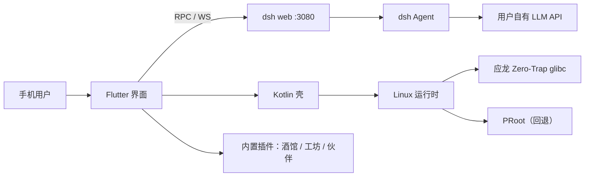

<div align="center">

# DSH NEXT

**DeepSeek Harness 的手机版本 · 可开关的内置插件 · 应龙运行时**

*把完整的 Linux 工具链和 AI 编程 Agent 装进 Android 手机——免 root、全程本地。*

[](https://github.com/SiFluxLab/DSH-NEXT/releases)
[](./LICENSE)

[](https://github.com/SiFluxLab/DSH-NEXT/releases)
[](#系统要求)
[](#运行时应龙替代-proot)
[](#产品定位)
[](#产品定位)
[](#架构概览)

</div>

---

## 产品定位

| 项目 | 说明 |
|------|------|
| **主交付物** | 签名 Android APK：内置 Linux 运行时 + DeepSeek Harness 引擎 + Flutter 原生界面 |
| **执行引擎** | 应龙（Zero-Trap，补丁版 glibc 在进程内翻译路径）；回退顺序 应龙 → tawcroot → direct → PRoot |
| **子系统** | Ubuntu 24.04 base（离线构建的 rootfs，真 bash / node / git / ripgrep 开箱即用） |
| **Agent** | `@deepseek-ai/dsh` 0.2.2-rc.1（Node 24.22.1，`dsh web` 起在本机回环端口） |
| **界面** | Flutter 原生界面（不是把电脑版网页塞进 WebView） |
| **内置插件** | 酒馆 / 创意工坊 / 伙伴小屋，三块都能在设置里单独开关 |
| **LLM** | 用户自有 API Key（应用内配置，壳内不含模型权重） |
| **数据边界** | 全程本地：数据在应用私有目录，对话默认不出设备 |

> 本仓库是 [dsh-go](https://github.com/ccch1mneyyy/dsh-go) 的**改名牌分支**：
> 重做了品牌与包名，把三个大功能做成可开关的内置插件，并把运行时从 PRoot 换成应龙。
> 上游作者的在线服务（更新镜像、远程中继、论坛、工坊、插件市场、统计上报）已全部断开，
> 指向保留域名 `dshnext.invalid`。许可仍是 **AGPL-3.0**，署名见 [NOTICE](./NOTICE)。

```
手机 APK
  ├─ Flutter 界面（对话 / 设置 / 酒馆 / 伙伴小屋 / 桌宠）
  ├─ Kotlin 壳（前台服务、运行时装配、手机操控、通知、更新）
  ├─ Linux 运行时（runtime/out，Ubuntu base + Node + 打过补丁的 dsh）
  │     └─ 应龙 Zero-Trap glibc ──► 免 ptrace 的路径翻译
  └─ dsh web ──► 127.0.0.1:3080/3081
```

---

## 内置插件

三块功能不再是「装了就在」的硬编码入口，而是可以单独启停的**内置插件**（设置 › 内置插件）：

| 插件 | 是什么 | 关掉之后 |
|------|--------|----------|
| **酒馆** | SillyTavern 兼容的角色扮演：角色卡、世界书、预设、正则、MVU、群聊、Live2D 舞台 | 模式列表、深链、入口消失；卡与对话数据保留 |
| **创意工坊** | 桌宠包 / 伙伴包的浏览、下载、投稿（需要自己的工坊服务端） | 伙伴页与桌宠设置里的入口消失 |
| **伙伴小屋** | Live2D 舞台 + 长期角色（轻量模式直连模型，完整模式跑在主机会话里） | 模式与主页入口消失；素材与记忆保留 |

关掉**只影响界面显示**，不删任何数据；重新打开后原样恢复。页面被深链或桌面小组件直接打开时，
会显示「这个功能已关闭」并给出跳回设置的按钮。

实现：`app/lib/state/builtin_plugins_state.dart`（唯一的开关事实源）+
`app/lib/ui/settings/builtin_plugins_page.dart`（开关页）+ 四个拦截点
（模式列表、深链路由、伙伴入口、工坊入口）。详见 [docs/dsh-next.md](./docs/dsh-next.md)。

---

## 运行时：应龙替代 PRoot

PRoot 用 ptrace 拦每一次 syscall，路径翻译的开销压在所有文件操作上。应龙（Zero-Trap）
把翻译搬进**打过补丁的 glibc**：syscall wrapper 层直接改写路径，进程内完成，不需要 ptrace。

| 场景 | PRoot | 应龙 | 倍数 |
|------|------:|-----:|-----:|
| 4 线程 `stat` 循环 | 4157 ms | 38 ms | **109×** |
| 模拟装包（解包 + chmod） | 6911 ms | 182 ms | **38×** |
| `tar` 解 3000 文件 | 4895 ms | 161 ms | **30×** |
| `du -sh` 5000 文件 | 934 ms | 209 ms | **4.5×**（含索引） |
| 引擎启动（`dsh --version`） | 212 ms | 175 ms | **−17.5%**（含索引） |
| 64 MB 顺序读写 | 68 ms | 63 ms | 持平（按 fd 走） |

> 数据来自应龙项目的实测（同机型、同 rootfs、交叉多轮取中位数），不是本仓库测的。
> 大文件 IO 没有收益；受益的是「syscall 密集」的活儿（装包、解包、遍历）。

工程上的三件事：

1. 补丁版 `ld-linux` + `libc.so.6` 随镜像放在 `/opt/yinglong/`，**不替换**镜像里的 `/lib`：
   `execve` 按 PT_INTERP 找解释器那一步不经过翻译，换了也没用。
2. 启动前先自检（`env -i … /bin/sh -c 'exec node --version'`），失败就照常 PRoot 启动，
   并把原因写进日志。
3. **不 exec `#!/bin/sh` 脚本**：shebang 由内核解析、不经翻译，会落到宿主 bionic sh 上并以 127 退出。
   启动器会读 `/usr/local/bin/dsh` 这个 shim，直接 exec 它内部的 `node --import=… bin.js`。

起不来时：`K_ZT_FAILED` 记下该运行时版本 → 下次启动直接 PRoot，换运行时后自动重试；
设置 › 应龙引擎 里的开关可以手动再试。

---

## 核心能力

| 模块 | 能力 |
|------|------|
| **对话** | 原生流式界面、工具卡、审批、会话搜索与回放；本机引擎或远程主机 |
| **应用内运行时** | 首次安装即在设备上解包 Ubuntu base + Node + 引擎，无需连电脑 |
| **手机操控** | 无障碍 / Shizuku / ADB 三条通道，逐条操作的审批与安全门 |
| **插件协议** | 原生插件协议 v1（contributions / invoke / stream / 视图与座位），插件可加胶囊、卡片、面板 |
| **远程主机** | SSH 与自建中继两条链路，远程会话与分享同一套状态 |
| **语音** | 本机判停（Silero VAD）+ 语音输入；语音朗读走系统或用户自填的 TTS |
| **桌宠 / 伙伴** | 像素桌宠 overlay（Android 悬浮窗、iOS PiP、鸿蒙卡片）与 Live2D 伙伴小屋 |
| **分享与导出** | 对话打码导出、加密托管链接（需自建 Worker）、分享码导入 |

---

## 架构概览



| 层 | 路径 | 职责 |
|----|------|------|
| 界面 | `app/lib/ui/` | 原生页面、设计系统、聊天渲染、各功能页 |
| 状态 | `app/lib/state/` | Riverpod 状态所有权；`builtin_plugins_state.dart` 是插件开关的事实源 |
| 客户端 | `packages/dsh_client/`、`packages/dsh_remote/` | 纯 Dart：DSH Web API、远程传输 |
| 酒馆引擎 | `packages/dsh_tavern/` | 纯 Dart 的 SillyTavern 兼容引擎（11 万行、253 个测试） |
| 原生 | `app/android/`（Kotlin）、`app/ios/`（Swift）、`app/ohos/`（ArkTS） | 运行时装配、启动方式、手机操控、通知、小组件 |
| 运行时 | `runtime/` | rootfs 构建、引擎补丁、桥接插件、`runtime/yinglong/`（应龙 payload） |
| 工具链 | `tooling/`、`sdk/plugin-kit/`、`examples/plugins/` | APK 构建、插件 SDK、示例插件 |

---

## 获取 APK

1. 打开 [Releases](https://github.com/SiFluxLab/DSH-NEXT/releases)，下载 `dsh-next-arm64-app-arm64-release.apk`
2. 直接安装（包名 `dev.sifluxlab.dshnext`，可与上游 dsh-go 并存）
3. 首次启动解包约 150 MB 的运行时，然后配置自己的 API Key

### 系统要求

| 项目 | 要求 |
|------|------|
| 架构 | arm64-v8a（应龙可用）；x86_64 仅供模拟器（走 PRoot） |
| 系统 | Android 8+（`minSdk 26`） |
| 存储 | 建议 2 GB 以上可用空间 |
| 网络 | 只有模型 API 需要联网；运行时离线可用 |

---

## 从源码构建

### GitHub Actions（推荐）

Actions → **Build APK** → Run workflow，选 `arm64` / `x64` / `both`；
勾 `release` 或推 `v*` 标签会把 APK 挂到 Release 上。

| 阶段 | 冷跑 | 热跑 |
|------|-----:|-----:|
| 运行时（arm64 / x64） | 2m00s / 3m37s | **18s / 22s**（哈希命中缓存） |
| APK（arm64 / x64） | 15m20s / 12m17s | **11m28s / 13m15s** |
| 整条流水线 | 约 33 分钟 | **14m23s** |

缓存策略：运行时按 `git ls-tree -r HEAD -- runtime` 的哈希缓存（并额外存成
`runtime-cache` release 资产，缓存被清也能直接下载）、Gradle 依赖与构建缓存、
NDK 缓存；构建失败自动重试一次。

### 本地

```bash
# 先构建一次运行时（会缓存下载物，后续很快）
runtime/build-runtime.sh arm64-v8a

# 出 APK（--no-companion：Live2D 素材包不在仓库里）
tooling/build-apk.sh --build-name 1.0.6 --no-companion

# 只跑应用侧检查
(cd app && flutter pub get && flutter analyze && flutter test)
```

| 脚本 | 产物 |
|------|------|
| `runtime/build-runtime.sh` | `runtime/out/<abi>/`（rootfs 压缩包 + jniLibs + manifest） |
| `tooling/build-apk.sh` | `app/build/app/outputs/flutter-apk/app-*.apk` |
| `.github/workflows/build-apk.yml` | 上面两件事 + Release 上传 |

签名：仓库 Secrets 里的 `ANDROID_KEYSTORE_BASE64` / `ANDROID_KEYSTORE_PASSWORD` /
`ANDROID_KEY_ALIAS` / `ANDROID_KEY_PASSWORD`；不配也能编，只是退回 debug 签名。

---

## 目录结构

```
DSH-NEXT/
├── README.md / README.en.md
├── LICENSE                     # AGPL-3.0
├── NOTICE                      # 上游署名与本 fork 的改动说明
├── app/                        # Flutter 界面 + Android/iOS/鸿蒙 原生实现
│   └── lib/
│       ├── state/              # Riverpod 状态（含 builtin_plugins_state.dart）
│       ├── ui/                 # 页面：chat / tavern / companion / pets / workshop / settings
│       └── l10n/               # 中英文案（parts/*.arb → gen/）
├── packages/
│   ├── dsh_client/             # 纯 Dart DSH Web API 客户端
│   ├── dsh_remote/             # 远程传输
│   └── dsh_tavern/             # SillyTavern 兼容酒馆引擎
├── runtime/
│   ├── build-runtime.sh        # rootfs + Node + 引擎 + 桥接
│   ├── patches/                # 引擎补丁（版本钉死）
│   ├── bridge/dsh-go-bridge/   # App ↔ 引擎的 HTTP 桥（内部名沿用上游）
│   └── yinglong/               # 应龙 payload（补丁版 loader + libc）
├── services/share-worker/      # 分享/工坊/统计的 Cloudflare Worker（自建可选）
├── market/                     # 插件目录源码（目前是空模板）
├── sdk/plugin-kit/             # 原生插件 SDK
├── examples/plugins/           # 插件示例
└── .github/workflows/build-apk.yml
```

---

## 版本

| 产品 | 说明 |
|------|------|
| 应用 | DSH NEXT `1.0.6`（`versionName 1.0.6`，包名 `dev.sifluxlab.dshnext`） |
| 运行时 | `r15-dsh0.2.2-rc.1-node24.22.1-ubuntu24.04.5` |
| 引擎 | `@deepseek-ai/dsh` 0.2.2-rc.1 |
| Node | 24.22.1 |
| 执行引擎 | 应龙（Zero-Trap，arm64）；PRoot / tawcroot / direct 作为回退 |

---

## 已知限制

- **品牌美术仍是上游版权素材**（`docs/assets/`、`app/assets/brand/`、桌宠包），
  按上游 `ASSETS.md` 不属于 AGPL；对外分发前必须换成自己的图。
- 应龙只做了**路径翻译**，索引（`ZT_CACHE`）与 `ztwatch` 还没接，引擎启动那 17% 只吃到一部分。
- 只提供 arm64-v8a 与 x86_64；`armeabi-v7a` 没有对应运行时。
- iOS 与鸿蒙工程只改了包名与名称，**未在真机验证**。
- 上游在线服务已断开：分享托管、远程中继、论坛、插件市场、统计上报都需要自建
  （`services/share-worker/` 是完整实现），或保持关闭。
- 酒馆的「做卡助手抓网页」、创意工坊投稿等依赖服务端的能力，在没有自建服务前不可用。

---

## 致谢

- [dsh-go](https://github.com/ccch1mneyyy/dsh-go)（AGPL-3.0）——本项目的上游
- **应龙 YingLong**（Zero-Trap）——补丁版 glibc 与免 ptrace 的路径翻译；源码与补丁在 `runtime/yinglong/NOTICE.md` 里说明来源
- [DeepSeek Harness](https://www.npmjs.com/package/@deepseek-ai/dsh) —— AI 编程 Agent CLI
- [Termux](https://termux.dev/)、[proot](https://proot-me.github.io/) —— 运行时与回退执行引擎
- [SillyTavern](https://github.com/SillyTavern/SillyTavern) —— 酒馆兼容目标
- [Live2D Cubism](https://www.live2d.com/) —— 伙伴小屋的运行库与模型素材（另行分发）
- README 的排版参考了 [DSHM](https://github.com/RochelimitDawn/DSHM) 与
  [dshm](https://github.com/sol5766/dshm) 两个同源项目的写法

---

## 许可证

本项目以 **[AGPL-3.0](./LICENSE)** 发布。它是 dsh-go 的衍生作品，因此必须继续以 AGPL 分发，
并且每个对外分发的构建都要让使用者能拿到完整对应源码。

- 上游署名、本 fork 的改动、以及**故意未改名**的内部标识（`dsh-go-bridge`、`/opt/dsh-go`、
  `dsh-go-companion-full` 预设、`dshGo` 服务名）见 [NOTICE](./NOTICE)。
- `/opt/yinglong/` 下的 libc 是 **glibc 2.39 的修改版**（LGPL-2.1-or-later），来源与义务见
  [runtime/yinglong/NOTICE.md](./runtime/yinglong/NOTICE.md)。
- 品牌素材与第三方组件的许可见 `ASSETS.md`（上游）与 [THIRD_PARTY_NOTICES.md](./THIRD_PARTY_NOTICES.md)。

---

<div align="center">

**DSH NEXT** · DeepSeek Harness 手机版 · 应龙运行时 · 插件可关

[Releases](https://github.com/SiFluxLab/DSH-NEXT/releases) ·
[Issues](https://github.com/SiFluxLab/DSH-NEXT/issues) ·
[docs/dsh-next.md](./docs/dsh-next.md) ·
[docs/architecture.md](./docs/architecture.md)

</div>
